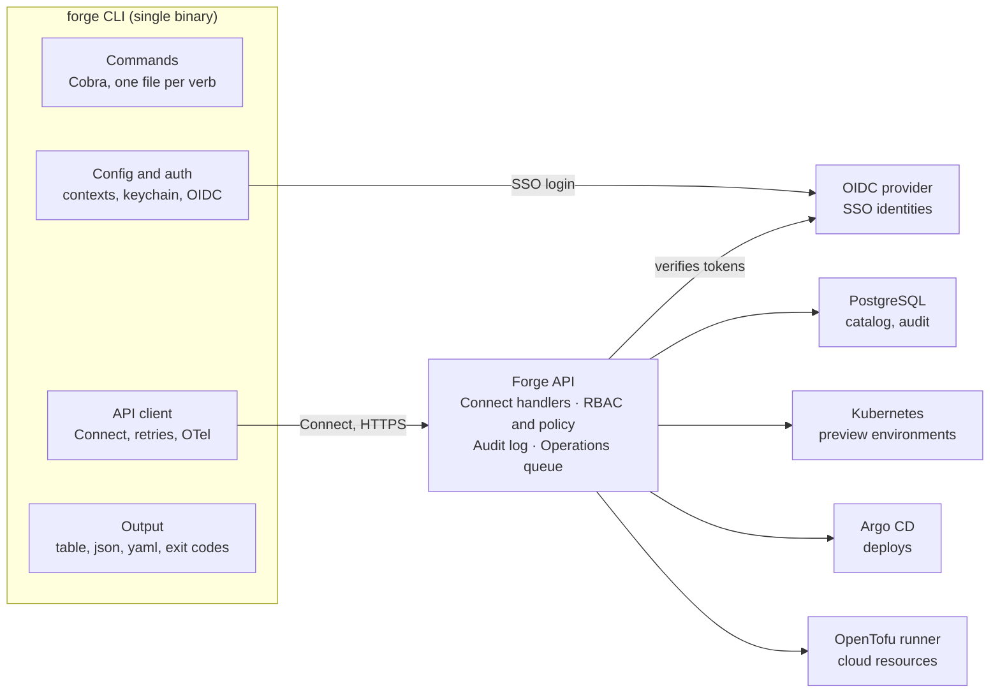

# Forge CLI Design Doc

Oct 7, 2026 · Showmino · Approved

## Summary and goals

`forge` is a single Go binary that lets a developer create, deploy and inspect a service without touching Kubernetes, OpenTofu or CI config directly. It is the first piece of Forge and the primary interface until the web dashboard exists, so every platform capability must be reachable from it.

**Goals**

- A new service goes from `forge create` to a running preview environment in under 10 minutes.
- One consistent grammar (`forge <noun> <verb>`) across catalog, templates, environments and deploys.
- Equally usable by a human at a terminal and by a script in CI: stable JSON output, exit codes and non-interactive auth.
- The CLI is a thin client. All policy, RBAC and audit live in the Forge API, so the CLI and the future dashboard behave identically.
- Idiomatic, production-grade Go that doubles as a reference for platform engineering practice.

**Non-goals for v1**

- No direct calls from the CLI to Kubernetes, Argo CD or OpenTofu. Those go through the API.
- No plugin system yet; the command set is fixed and versioned with the binary.
- No offline mode beyond reading cached config and local templates.
- No Windows-specific installers in the first release (the binary still builds for Windows).

## Users and design principles

Three users shape the design: an application developer who wants a service running, a platform engineer who curates templates and policy, and a CI pipeline that calls `forge` without a human present.

1. **Golden path first.** The default flags produce the approved setup; deviating takes an explicit flag, never a prompt maze.
2. **Noun, then verb.** `forge service list`, `forge env create`. Predictable enough that `--help` is rarely needed.
3. **Thin client, fat API.** The CLI validates input shape and renders output. Authorization, policy and side effects happen server side.
4. **Scriptable by default.** Every command supports `-o json`, never prompts when stdin is not a TTY, and returns documented exit codes.
5. **Safe by default.** Destructive verbs (`delete`, `env destroy`, `rollback`) require confirmation or `--yes`, and support `--dry-run`.
6. **Fast feedback.** Long operations stream progress and can be detached with `--wait=false`, then resumed with `forge op watch <id>`.

## Command surface

The v1 CLI has ten command groups; each maps one-to-one to an API resource so the dashboard can reuse the same endpoints. The Phase column ties each group to the delivery plan below.

| Group | Verbs | Example | Phase |
| --- | --- | --- | --- |
| `auth` | `login`, `logout`, `status`, `token` | `forge auth login --sso` | 1 |
| `context` | `list`, `use`, `current`, `set` | `forge context use staging-eu` | 1 |
| `service` | `list`, `get`, `register`, `update`, `owners`, `deps`, `delete` | `forge service get payments -o yaml` | 1 |
| `template` | `list`, `get`, `lint` | `forge template list --tag go` | 2 |
| `create` (shortcut) | scaffold from a template | `forge create payments --template go-grpc --team billing` | 2 |
| `env` | `list`, `create`, `get`, `destroy`, `extend` | `forge env create pr-142 --service payments --ttl 48h` | 3 |
| `deploy` | `start`, `status`, `history`, `rollback`, `promote` | `forge deploy start payments --env staging --ref v1.4.2` | 4 |
| `resource` | `plan`, `apply`, `list`, `get` | `forge resource plan -f forge.yaml` | 5 |
| `audit` | `list`, `get` | `forge audit list --service payments --since 7d` | 5 |
| `op` | `list`, `watch`, `cancel` | `forge op watch op_9f2c` | 3 |

Utility commands ship in Phase 1: `forge version`, `forge completion <shell>`, `forge doctor` (checks config, auth, API reachability and version skew) and `forge init` (writes `forge.yaml` for an existing repo).

**Global flags**

- `--context`, `-c`: which Forge installation and default namespace to target.
- `--output`, `-o`: `table` (default on a TTY), `json`, `yaml`, `name`.
- `--quiet`, `-q` and `--verbose`, `-v`: logging level; `-v` also prints request IDs and trace IDs.
- `--no-input`: fail rather than prompt; implied when stdin is not a TTY.
- `--dry-run`, `--yes`: on mutating commands.
- `--timeout`, `--wait`: for long-running operations.

**The `forge.yaml` manifest** lives in each service repo and is the declarative source of truth for the service's catalog entry, environments and resources. Commands run inside a repo read it, so `forge deploy start --env staging` needs no service name there.

## Configuration and authentication

Config is layered and contexts work like kubeconfig: one file lists Forge installations, and the CLI targets one at a time. Credentials never live in the config file.

**Precedence**, highest first:

1. Command-line flags.
2. Environment variables, prefixed `FORGE_` (`FORGE_CONTEXT`, `FORGE_TOKEN`, `FORGE_API_URL`).
3. Repo manifest `forge.yaml` for service-scoped defaults.
4. User config at `$XDG_CONFIG_HOME/forge/config.yaml` (`~/.config/forge` on Linux and macOS).
5. Built-in defaults.

```yaml
current-context: staging-eu
contexts:
  - name: staging-eu
    api: https://forge.staging.example.com
    namespace: billing
  - name: prod
    api: https://forge.example.com
    namespace: billing
preferences:
  output: table
  color: auto
```

**Auth flows**

- **Interactive humans:** OIDC device authorization flow (`forge auth login`). It works over SSH and in containers because it needs no local browser callback. A `--web` option uses the authorization code flow with PKCE and a loopback redirect when a browser is available.
- **CI and automation:** short-lived tokens from workload identity federation (GitHub Actions OIDC, GitLab, Kubernetes service account tokens) exchanged at the API for a Forge token. Long-lived personal access tokens exist as a fallback, scoped and with a mandatory expiry.
- **Storage:** access and refresh tokens go in the OS keychain (macOS Keychain, Secret Service, Windows Credential Manager) via a keyring library, with an encrypted-file fallback for headless Linux and an explicit `FORGE_TOKEN` override.
- **Refresh:** the HTTP client refreshes transparently on 401 once, then fails with exit code 4 and a hint to run `forge auth login`.

RBAC is enforced only by the API. The CLI reads the caller's permissions from `forge auth status` purely to hide or grey out actions in help and prompts.

## Talking to the Forge API

The recommendation is one Protobuf contract served with ConnectRPC, so the CLI speaks gRPC-compatible RPC while browsers and curl get plain JSON over HTTP from the same handlers. This meets the "REST and gRPC" goal without maintaining two APIs or a grpc-gateway translation layer.

| Option | For | Against |
| --- | --- | --- |
| ConnectRPC (recommended) | One `.proto` source; works over HTTP/1.1 and HTTP/2, so corporate proxies and load balancers are not a problem; JSON for free; generated Go client | Smaller ecosystem than raw gRPC |
| gRPC plus grpc-gateway | Mature, widely known | Two servers or a proxy to run; HTTP/2 required end to end for gRPC |
| REST with OpenAPI | Simplest for browsers and curl | Weaker typing and streaming; client generation is clunkier in Go |

**Contract and client**

- Protos live in `proto/forge/v1/`, linted and checked for breaking changes with `buf` in CI.
- The generated Go client is wrapped by a small `pkg/client` package that adds auth, retries, request IDs and tracing, so commands never build requests by hand.
- Resource names follow AIP style (`services/payments`, `environments/pr-142`) to keep CLI arguments and API paths aligned.

**Long-running work** (environment creation, deploys, OpenTofu applies) returns an `Operation` immediately. The CLI streams its events with a server-streaming RPC, falling back to polling, and can reattach later with `forge op watch`.

**Versioning and compatibility**

- The API is versioned by package (`forge.v1`). The CLI sends its version in a `forge-client-version` header; the server answers with its version and a minimum supported client.
- The CLI supports the current server minor version and one before it. `forge doctor` and a once-a-day check warn on skew.

**Errors and retries**

- The server returns rich error details (`BadRequest` field violations, `PreconditionFailure`, `ErrorInfo` with a stable reason code). The CLI renders them as a one-line message plus a hint, and prints the full detail with `-v` or `-o json`.
- Idempotent reads retry with jittered backoff on `Unavailable`. Mutations carry a client-generated idempotency key so a retry never creates a second environment or deploy.

## Output and scripting conventions

Human output goes to stdout as tables; everything diagnostic goes to stderr, so `forge service list -o json | jq` is always clean.

- **Formats:** the default is `table`, even when piped; scripts pass `-o json` explicitly so output never changes shape by surprise. JSON output is the API resource itself, versioned with the API.
- **Colour and spinners:** on only when stdout is a TTY; honour `NO_COLOR` and `--no-color`.
- **Prompts:** only on a TTY and never with `--no-input`. Missing required input then fails with exit code 2 and names the flag.
- **Confirmation:** destructive verbs ask to type the resource name; `--yes` skips it.
- **Help:** every command has a one-line summary, a longer description and at least two examples. Typos get "did you mean" suggestions.

**Exit codes**

| Code | Meaning |
| --- | --- |
| 0 | Success |
| 1 | Unexpected error |
| 2 | Invalid usage or missing input |
| 3 | Not found |
| 4 | Not authenticated or token expired |
| 5 | Permission denied by RBAC or policy |
| 6 | Conflict or failed precondition |
| 7 | Operation failed (deploy or apply finished unsuccessfully) |
| 8 | Timed out waiting |

## Architecture and package layout

The CLI has four internal layers and one outbound dependency, the Forge API; the only exception is the browser or device-code login, which goes to the identity provider.



The API is the one place that touches PostgreSQL, Kubernetes, Argo CD and OpenTofu, which is what lets RBAC, policy and audit apply to every action.

```text
forge/
  cmd/forge/main.go      # builds the root command, maps errors to exit codes
  internal/cli/          # one package per noun: service, env, deploy, ...
    root.go              # global flags, context resolution
  internal/config/       # layered config and contexts
  internal/auth/         # OIDC device flow, keyring storage, refresh
  internal/output/       # table, json and yaml printers
  internal/manifest/     # forge.yaml schema and validation
  pkg/client/            # Connect client wrapper: auth, retries, OTel
  proto/forge/v1/        # API contract, shared with the server
  gen/                   # buf-generated code
```

**Conventions**

- No package-level globals. Each command is built by a constructor that takes a `Deps` struct (IO streams, config, a client factory), following the `gh` CLI pattern, so tests inject fakes and run in parallel.
- Commands use `RunE` and return typed errors; only `main` decides the exit code and prints.
- `context.Context` flows from the root command with signal handling, so Ctrl-C cancels in-flight requests cleanly.
- Config is a small typed loader over YAML and environment variables rather than Viper, keeping precedence explicit and testable.
- Dependencies stay few: Cobra, connect-go, the OpenTelemetry SDK, a keyring library, an OIDC library and a table renderer.

## Observability, testing and distribution

**Observability**

- Every request carries a request ID and a W3C `traceparent` header via the OpenTelemetry HTTP instrumentation, so a CLI call can be found in server traces.
- Local trace export is opt-in: `FORGE_TRACE=1` writes spans to stderr, and `OTEL_EXPORTER_OTLP_ENDPOINT` sends them to a collector.
- Usage telemetry (command name, duration, exit code, CLI version; no arguments or resource names) is off for now; see Open questions.

**Testing**

- Unit tests per command with the API client behind an interface and a fake implementation.
- Golden-file tests for `table`, `json` and `yaml` output so formatting changes are reviewed deliberately.
- Script tests with `testscript` that run the real binary against an in-process fake Forge server, covering flags, exit codes and prompts.
- Contract tests generated from the protos, plus `buf breaking` in CI.

**Release and distribution**

- GoReleaser builds static binaries (`CGO_ENABLED=0`) for Linux, macOS and Windows on amd64 and arm64.
- Channels: GitHub Releases, a Homebrew tap, a container image for CI, and `go install` for contributors.
- Artifacts are checksummed, signed with cosign keyless signing, and ship an SBOM.
- Semantic versioning; `forge version` prints the CLI version, commit, build date and the server version of the current context.

## Phased delivery plan

Build in five phases, sequenced rather than dated, and move on only when a phase's exit gate passes for a real user. Phases 1 to 4 are done; Phase 5 is next. Before it, the k3s install moved to GitHub login and PostgreSQL storage (`docs/specs/2026-10-09-groundwork-auth-storage-design.md`).

| Phase | Scope | Exit gate |
| --- | --- | --- |
| 1 · Foundations (done) | auth, context, service list / get / register; doctor, version, completion, init; API skeleton, protos, CI, signed releases | Log in with SSO and register a service from a Homebrew install |
| 2 · Templates and scaffolding (done) | template list / get / lint; `forge create` from a Git template repo; first golden path: Go gRPC service | A scaffolded service passes its own CI and appears in the catalog |
| 3 · Environments (done) | env create / list / destroy / extend with a TTL; operations: op watch, streamed progress; one Kubernetes namespace per preview | `forge create` to a running preview environment in under 10 minutes |
| 4 · Deployments (done) | deploy start / status / history; rollback and promote through Argo CD; deploys from CI with workload identity | A team ships to staging from CI without kubectl or Argo access |
| 5 · Resources and audit | resource plan / apply via the OpenTofu runner; policy checks on every plan; audit list / get | Every mutating action is traceable in the audit log by user and service |

Each phase grows the API and the CLI together, so the CLI never ships a command the server cannot back. The command table above tags every group with its phase.

**Phase 1 starting point:**

- [x] Create the Go monorepo with `cmd/forge`, `internal/`, `pkg/client` and `proto/forge/v1`.
- [x] Define `ServiceCatalogService` and `AuthService` protos and generate clients with `buf`.
- [x] Implement the root command, config loader, contexts and output printers with golden tests.
- [x] Implement `forge auth login` against a local Dex instance.
- [x] Set up CI (lint, test, `buf breaking`) and GoReleaser.

## Open questions

Each has a working default in this draft; an answer changes the plan only where noted.

- [x] **API protocol:** Decided: ConnectRPC. Classic gRPC with grpc-gateway is ruled out; Phase 1 builds the Connect API skeleton.
- [x] **Identity provider:** Decided: Dex for local development first. The production provider (Okta, Entra ID, Google, Keycloak) is deferred until Forge is offered as a product.
- [x] **Repo layout:** Decided: one Go monorepo with a single module for the CLI, API and protos.
- [x] **Deploy engine:** Decided: Argo CD is the only GitOps target for Phase 4. Flux support comes later.
- [x] **Resource backend:** Decided: OpenTofu jobs run by the API via a job runner, not Crossplane.
- [x] **Templates source:** Decided: a Git repo the platform team owns, versioned by tag.
- [x] **Telemetry:** Decided: off for now. Anonymous CLI usage metrics stay opt-in with `forge config set telemetry on`.
- [x] **Distribution:** Decided: a Homebrew tap and GitHub Releases for now. apt, yum and Scoop packages can come later.
- [x] **Local development:** Decided: Phase 1 targets the existing k3s cluster, so no `kind`-based local Forge stack is needed for demos.
- [x] **Template format:** Decided: the Forge format, `template.yaml` with typed parameters plus a `skeleton/` folder rendered with Go `text/template`, versioned by repo-wide tags in one templates repo. No Backstage importer (see `docs/specs/2026-10-08-phase-2-templates-design.md`).